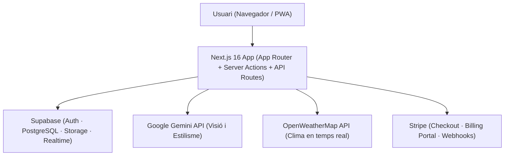

# thelook — Smart AI Digital Wardrobe

[](https://nextjs.org/)
[](https://react.dev/)
[](https://tailwindcss.com/)
[](https://supabase.com/)
[](https://stripe.com/)
[](./LICENSE)

**thelook** és una aplicació web de Fashion Tech que permet digitalitzar el teu armari mitjançant visió per computador i rebre recomanacions d'outfits personalitzades amb Intel·ligència Artificial (**Google Gemini**) adaptades a l'ocasió, l'estil i la meteorologia en temps real. Inclou un model freemium amb subscripcions via **Stripe**, blog integrat i panell d'administració.

---

## Taula de continguts

- [Funcionalitats principals](#funcionalitats-principals)
- [Stack tecnològic](#stack-tecnològic)
- [Arquitectura del sistema](#arquitectura-del-sistema)
- [Estructura del projecte](#estructura-del-projecte)
- [Prerequisits](#prerequisits)
- [Instal·lació i configuració](#installació-i-configuració)
- [Variables d'entorn](#variables-dentorn)
- [Webhooks de Stripe en local](#webhooks-de-stripe-en-local)
- [Rutes i API](#rutes-i-api)
- [Equip](#equip)
- [Llicència](#llicència)

---

## Funcionalitats principals

- **Digitalització intel·ligent de peces (`/app/afegir`)**: Captura amb càmera o pujada de fotos amb anàlisi automàtica via Google Gemini Vision que extreu 13 atributs (categoria, subcategoria, color principal/secundari, patró, material, formalitat, calidesa, tallatge, estacions, marca, descripció i tags).
- **Armari virtual interactiu (`/app/armari`)**: Carpetes per categoria, cerca instantània, filtres avançats per múltiples atributs, favorits i edició en temps real amb estat global (`Zustand`) i sincronització `Supabase Realtime`.
- **Generador d'outfits amb IA (`/app/outfits`)**: Recomanacions basades en ocasió, estil, historial recent i dades meteorològiques en temps real (`OpenWeatherMap` + geolocalització GPS/IP), amb intercanvi manual de peces.
- **Subscripcions Freemium amb Stripe (`/pricing`, `/app/perfil`)**: Límits per pla (`Free` vs `Pro`), Stripe Checkout, Customer Portal, cancel·lació/reactivació i sincronització per webhooks.
- **Blog i Panell d'Administració (`/blog`, `/admin`)**: Editor d'articles amb sanitització HTML (`isomorphic-dompurify`), pujada d'imatges a Supabase Storage, likes i dashboard admin per gestionar usuaris i plans.
- **PWA & UI Glassmorphism**: Suport per tema clar/fosc, navegació tàctil per swipe entre pantalles i manifest PWA instal·lable.

---

## Stack tecnològic

| Capa | Tecnologia | Funció |
|---|---|---|
| **Framework** | Next.js 16 (App Router) | SSR, Server Actions, API Routes |
| **UI & Estat** | React 19 + Tailwind CSS 4 + Zustand | Components, estils i estat reactiu |
| **Animacions & Icones** | Framer Motion + Lucide React | Transicions, modals i iconografia |
| **Backend & BD** | Supabase (PostgreSQL, Auth, Storage, Realtime) | Autenticació, persistència i imatges |
| **Intel·ligència Artificial** | Google Gemini API (`@google/generative-ai`) | Anàlisi de peces i generació d'outfits |
| **Meteorologia** | OpenWeatherMap API | Clima real per a recomanacions |
| **Pagaments** | Stripe + Stripe Webhooks | Checkout i gestió de subscripcions |

---

## Arquitectura del sistema



---

## Estructura del projecte

```text
thelook/
├── public/                     # Assets estàtics (logos SVG/PNG, vídeo demo, manifest PWA)
├── src/
│   ├── app/
│   │   ├── api/                # API Routes (analyze-garment, generate-outfit, update-outfit, weather, blog, webhooks/stripe)
│   │   ├── actions/            # Server Actions (stripe, blog)
│   │   ├── admin/              # Panell d'administració
│   │   ├── app/                # Zona autenticada (dashboard, armari, afegir, outfits, perfil)
│   │   ├── auth/               # Callbacks, confirmació OTP i signout
│   │   ├── blog/               # Blog públic, categories i editor
│   │   ├── legal/              # Política de privacitat i termes
│   │   ├── login/              # Inici de sessió i registre
│   │   ├── pricing/            # Pàgina de plans
│   │   └── register/           # Registre d'usuaris
│   ├── components/             # Components UI, ads i blog
│   ├── hooks/                  # Custom hooks (filtres, geolocalització, swipe, tema, clima)
│   ├── lib/                    # Clients Stripe, plans i constants de roba
│   ├── store/                  # Store global Zustand
│   ├── utils/                  # Utilitats (clients Supabase i blog)
│   └── proxy.js                # Protecció i refresc de sessió Next.js
├── supabase_blog_setup.sql     # Esquema SQL i polítiques RLS del blog
├── .env.example                # Plantilla de variables d'entorn
└── package.json
```

---

## Prerequisits

- **Node.js** v20+ (mínim v18.18.0)
- **npm** v9+
- **Git**
- Comptes gratuïts / claus API a:
  - [Supabase](https://supabase.com/)
  - [Google AI Studio (Gemini)](https://aistudio.google.com/)
  - [OpenWeatherMap](https://openweathermap.org/api) *(opcional: si no es configura, l'app retorna dades simulades en desenvolupament)*
  - [Stripe](https://stripe.com/) *(mode test)*

---

## Instal·lació i configuració

### 1. Clonar el repositori

```bash
git clone https://github.com/unaiea-dev/thelook-ai.git
cd thelook-ai
```

### 2. Instal·lar les dependències

```bash
npm install
```

### 3. Configurar les variables d'entorn

Copia la plantilla `.env.example` a `.env.local` i omple-la amb les teves pròpies claus:

```bash
cp .env.example .env.local
```

### 4. Base de dades a Supabase

Executa l'script [`supabase_blog_setup.sql`](./supabase_blog_setup.sql) a l'SQL Editor del teu projecte Supabase per crear les taules, triggers, polítiques RLS i bucket del blog (`blog_posts`, `blog_likes`, `blog-images`), juntament amb les taules principals de l'app (`profiles`, `garments`, `outfits`) i el bucket `garment-photos`.

### 5. Executar en local

```bash
npm run dev
```

Obre [http://localhost:3000](http://localhost:3000) al navegador.

| Comanda | Descripció |
|---|---|
| `npm run dev` | Servidor de desenvolupament |
| `npm run build` | Compilació de producció |
| `npm run start` | Servidor de producció |
| `npm run lint` | Comprovació amb ESLint |

---

## Variables d'entorn

Consulta [`.env.example`](./.env.example) per veure totes les variables disponibles:

| Variable | Descripció |
|---|---|
| `NEXT_PUBLIC_SUPABASE_URL` | URL del projecte Supabase |
| `NEXT_PUBLIC_SUPABASE_ANON_KEY` | Clau pública (`anon`) de Supabase |
| `SUPABASE_SERVICE_ROLE_KEY` | Clau de servei de Supabase (només servidor / webhooks) |
| `GEMINI_API_KEY` | Clau de l'API de Google Gemini |
| `OPENWEATHER_API_KEY` | Clau d'OpenWeatherMap per a dades meteorològiques |
| `STRIPE_SECRET_KEY` | Clau secreta de Stripe (`sk_test_...`) |
| `NEXT_PUBLIC_STRIPE_PUBLISHABLE_KEY` | Clau pública de Stripe (`pk_test_...`) |
| `NEXT_PUBLIC_STRIPE_PRICE_MONTHLY` | ID del preu mensual a Stripe (`price_...`) |
| `NEXT_PUBLIC_STRIPE_PRICE_ANNUAL` | ID del preu anual a Stripe (`price_...`) |
| `STRIPE_WEBHOOK_SECRET` | Secret de signatura del webhook de Stripe (`whsec_...`) |
| `NEXT_PUBLIC_ADSENSE_CLIENT_ID` | *(Opcional)* ID de Google AdSense |

---

## Webhooks de Stripe en local

Instal·la el [Stripe CLI](https://docs.stripe.com/stripe-cli) al teu sistema i executa'l en un segon terminal juntament amb `npm run dev`:

```bash
stripe login
stripe listen --forward-to localhost:3000/api/webhooks/stripe
```

Copia el `webhook signing secret` (`whsec_...`) que imprimeix el CLI dins del teu `.env.local` a `STRIPE_WEBHOOK_SECRET` i reinicia el servidor de Next.js.

---

## Rutes i API

### Pàgines principals

- `/` — Landing page (Hero, funcionalitats, preus, equip i preview del blog)
- `/login` i `/register` — Autenticació amb Supabase
- `/pricing` — Plans Free i Premium (mensual / anual)
- `/blog` — Blog públic, filtrat per categories i editor per a usuaris autenticats
- `/legal` — Política de privacitat i termes d'ús
- `/app`, `/app/armari`, `/app/afegir`, `/app/outfits`, `/app/perfil` — Zona privada de l'app
- `/admin` — Panell d'administració (requereix rol `admin`)

### API Routes (`src/app/api/`)

| Endpoint | Mètode | Descripció |
|---|---|---|
| `/api/analyze-garment` | `POST` | Analitza una imatge amb Gemini Vision i retorna metadades de la peça |
| `/api/generate-outfit` | `POST` | Genera una combinació d'outfit segons l'armari, ocasió, estil i clima |
| `/api/update-outfit` | `POST` | Actualitza les peces d'un outfit guardat |
| `/api/weather` | `GET` | Obté el clima actual via coordenades o IP (`OpenWeatherMap`) |
| `/api/blog/upload-image` | `POST` | Puja imatges de portada del blog a Supabase Storage |
| `/api/webhooks/stripe` | `POST` | Processa events de subscripció de Stripe |

---

## Equip

- **Unai Escobar** — CTO & Desenvolupament Full-Stack
- **Iván Benítez** — CPO & Disseny UX/UI
- **Maria** — CMO & Màrqueting

---

## Llicència

Distribuït sota la llicència MIT. Consulta [`LICENSE`](./LICENSE) per a més informació.
